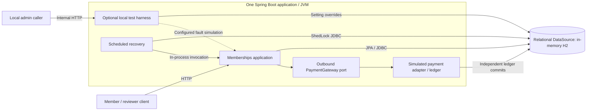

# Architecture and design

Contents: [overview](#overview) · [decisions](#decisions-and-trade-offs) · [transactions](#transaction-boundaries) · [consistency](#concurrency-and-consistency) · [retries and recovery coordination](#retries-and-recovery-coordination) · [caching](#read-caching) · [limitations](#limitations-and-review-caveats).

## Overview

The system is a modular monolith: one Spring Boot application with logical plan, membership, inventory, payment and idempotency components, plus persisted saga recovery. A Java `service` package is part of this deployment; it is not a separately deployed network service. The saga coordinates local commits and payment work within the application, without a broker.

The implementation targets Java 21 and uses Spring Boot 4.0.0, Gradle wrapper 9.5.1, Spring Framework 7 native retry and ShedLock Spring/JDBC 7.10.1. JPA/Hibernate, H2, Lombok and the other dependency-managed libraries are resolved by the build. H2 is the only configured database; each default application JVM owns its own in-memory database.

This diagram describes deployment and infrastructure boundaries. The separate [logical component diagram](05-services-and-components.md#component-collaboration) explains application responsibilities.

There is no real network payment provider in this deployment. The simulated adapter shares the application DataSource but commits its ledger independently to model a provider effect surviving a failed local step. A future multi-pod deployment would need a shared durable database, suitable configuration/migrations and database-specific verification. The current per-process H2 setup supplies neither shared rows nor shared locks across JVMs.

API contracts live in [03](03-api-reference.md); schemas in [04](04-data-model.md); logical components and responsibilities in [05](05-services-and-components.md); runtime sequences, outcomes and state transitions in [06](06-business-flows-and-execution.md); setup and configuration in [07](07-local-setup-and-manual-testing.md).

## Decisions and trade-offs

| Design concern | Choice and reason | Consequence |
| --- | --- | --- |
| Keep the exercise operable | One application with capability-oriented components and in-memory H2 | Simple startup; application restarts lose data |
| Coordinate payment with local state | Persist a synchronous saga and payment outcomes between short local commits | An HTTP error can leave recoverable work; payment cannot join the local ACID boundary |
| Protect finite capacity | Conditional database counter updates and reservation-state transitions | Integrity rests on database atomicity, not JVM locks |
| Prevent duplicate unlimited ownership | Insert a unique normalized-member claim before charging | Pending claims protect in-flight work; identity is name-based and there is no automatic expiry |
| Reject stale workflow writes | Versioned entities plus narrow optimistic-lock retries | Only eligible local conflicts retry; business conflicts remain immediate failures |
| Recognize repeated requests | Persist client idempotency separately from a stable provider payment key | Client replay and provider replay address different failure boundaries |
| Keep mutable reads authoritative | Cache static plan metadata only | More database reads; future catalogue writes would need invalidation |
| Coordinate recovery | ShedLock for scheduled batches and conditional claims for individual sagas | Shared-database coordination is possible, but leases are time-based rather than exactly-once execution guarantees |

The runtime effects of these decisions, including races and failed payments, are described in [business flows](06-business-flows-and-execution.md).

## Transaction boundaries

This table is the canonical description of local atomicity. `@Transactional` defaults to **REQUIRED**: a collaborator joins an existing transaction. Its own declared timeout does not start a new boundary or replace the timeout of a transaction it joins. Repositories participate in their caller's transaction.

| Boundary / owner | Work committed or rolled back together | Transaction behavior |
| --- | --- | --- |
| `PurchaseInitializationTransaction.createInProgress` | Idempotency insert, saga insert and validation transition | REQUIRED; unique-key race resolution happens in the nontransactional caller after the losing transaction rolls back |
| `PurchaseInitializationTransaction.createFailed` | Idempotency insert and terminal plan-validation error | REQUIRED; no saga is needed for this definitive pre-saga failure |
| `PurchaseResourceReservation` → `PurchaseResourceReservationTransaction.reserve` | Unlimited claim, finite inventory reservation and `RESOURCES_RESERVED` | Retry supplies a fresh REQUIRES_NEW transaction; the proxied REQUIRED collaborator and all resource delegates join it |
| `PurchasePaymentPreparation.prepare` | Payment-attempt insert and `PAYMENT_PENDING` | Fresh retry transaction; committed before provider invocation |
| `PaymentAttemptStore.startAttempt` / `recordRetryableFailure` | Reloaded payment-attempt count, status or retryable failure | Fresh retry transaction for each operation |
| `PurchasePaymentOutcomeStore` | Payment outcome and corresponding saga success, unknown or compensating state | Fresh retry transaction for each operation |
| `PurchaseFinalizer` → `PurchaseFinalizationTransaction` | Purchase snapshot, claim activation, reservation commit, completed idempotency and saga | Nontransactional facade invokes REQUIRED work inside the fresh retry transaction |
| `PurchaseCompensationService` → `PurchaseCompensationTransaction` | Resource release, compensation completion and failed idempotency | REQUIRED work inside the fresh retry transaction; failed cleanup cannot partially commit |
| `PurchaseSagaRecoveryTransaction.failBeforeResources` | Failed saga and fail-if-in-progress idempotency | REQUIRED; recovery wraps it in optimistic retry; the normal pre-resource error path invokes it directly |
| `PurchaseSagaStore` selection, claim and direct transitions | Candidate read, conditional lease claim, or one state transition per call | Selection is read-only REQUIRED; claim/direct transitions are REQUIRED with a one-second timeout. Defer/manual-review operations instead use fresh retry transactions |
| `SimulatedPaymentLedger` → `SimulatedPaymentLedgerTransaction` | Provider-key/amount lookup or insert, or collision-winner lookup | Each collaborator call uses REQUIRES_NEW; an insert loser rolls back fully before a separate read validates/replays the winner |
| Harness overrides and ordinary catalogue/read work | One settings update, seed operation or read | Harness updates use fresh retry transactions. Seeding uses REQUIRED; query services use read-only REQUIRED |

`OptimisticLockRetryPolicy` creates `TransactionTemplate(REQUIRES_NEW)` **inside** the retry callback, with a one-second timeout. Each attempt reloads the relevant entities and includes commit-time conflicts. The reservation, finalization and compensation collaborators are separate Spring beans, so their transaction advice is invoked through proxies. The same local write paths support normal processing and recovery.

The complete purchase is not one ACID transaction. Provider calls, synchronous backoff and recovery provider waiting remain outside these local write transactions. Likewise, a simulation method invoked reflectively does not gain transaction advice merely because it has an annotation; see [FaultInjectable](05-services-and-components.md#faultinjectable-simulation). The simulator's separate ledger transaction can commit even when later purchase work fails.

For what survives each interruption point, see the [crash-window table](06-business-flows-and-execution.md#crash-windows), rather than inferring runtime order from this transaction inventory.

## Concurrency and consistency

Capacity changes use conditional database updates because an application-side read/check/write could race. Reservation-status compare-and-set ensures only the winning commit/release changes counters. Unique unlimited claims provide a database-wide ownership gate before external payment work; a process-local lock would not protect separate instances.

Optimistic versions protect saga, payment-attempt, idempotency and harness-setting entity writes. Bulk recovery claims explicitly test state/version/time and increment the version, avoiding reliance on stale candidate reads. Resource reservation combines all claims/counters with the saga transition in one transaction, so a failed state change cannot leave newly committed resources behind.

Persisted client idempotency protects request initialization and replay; provider-key/amount uniqueness protects the simulated payment effect independently. A provider key is not a substitute for a client payload hash, and a unique local purchase does not establish exactly-once financial effects. See [replay scenarios](06-business-flows-and-execution.md#idempotency-scenarios) and [payment outcomes](06-business-flows-and-execution.md#payment-outcomes-and-compensation) for the observable consequences.

These mechanisms are verified with H2 integration tests, including [atomic reservation rollback/version conflicts](../src/integrationTest/java/com/glofox/memberships/membership/saga/orchestration/reservation/PurchaseResourceReservationAtomicityTests.java) and [concurrent purchases](../src/integrationTest/java/com/glofox/memberships/concurrency/PurchaseConcurrencyTests.java). They do not establish PostgreSQL or actual multi-pod correctness without deployment-specific testing.

## Retries and recovery coordination

### Retry policies

The three retry scopes serve different purposes and retain independent budgets:

| Scope | Eligibility and budget | Backoff / boundary |
| --- | --- | --- |
| Local optimistic locking | Spring `ObjectOptimisticLockingFailureException` and JPA `OptimisticLockException`, including eligible causes; three total attempts (`maxRetries=2`) | Initial 20ms, multiplier 2, maximum base delay 50ms, jitter 5ms. Nominal retry bases are 20ms then 40ms. Each attempt is a fresh one-second local transaction |
| Synchronous payment | Only `FailureType.TRANSIENT`; three total gateway calls, including the first | `min(120ms, 15ms << retryIndex) + random[1,15]ms`: 16–30ms before call two, 31–45ms before call three. The same command/provider key is reused; no local transaction spans the call or sleep |
| Recovery payment reconciliation | Unresolved persisted attempts; at most six total started payment attempts, including synchronous attempts | Each failed/unknown recovery attempt is scheduled for a later pass. Base seconds are `min(300, 5 << min(attemptCount,5))`, plus integer jitter from 1 through `max(1, base/4)` inclusive. The current expression reaches a 160-second base, not 300 seconds |

Local retry does not include business validation, inventory exhaustion, payment declines or arbitrary exceptions. Exhaustion becomes the controlled 409 `OPTIMISTIC_LOCK_RETRY_EXHAUSTED`. Interrupted optimistic retry restores the interrupt flag and propagates an internal failure. Payment decline, permanent error, unknown outcome and interrupted backoff retain their distinct [runtime handling](06-business-flows-and-execution.md#payment-outcomes-and-compensation).

Only the gateway invocation is inside the synchronous provider-exception catch scope. Attempt/outcome persistence and compensation errors propagate independently. A successful charge followed by failed success persistence must remain recoverable; it is not retried as another synchronous gateway call or reclassified as a definitive decline.

### Scheduler and lease coordination

ShedLock protects scheduled batch entry, while a conditional per-saga claim protects individual recovery work, including programmatic invocations. Both are needed: the scheduler lock alone does not cover every possible caller, and a candidate list alone is not an ownership claim. ShedLock uses JDBC/database time on the existing DataSource; per-saga selection/lease times use the application clock. No fencing token or exactly-once claim is made.

Defaults are a UTC six-field cron every 15 seconds, batch size ten (validated 1–10), minimum inactivity 90 seconds, a three-minute per-saga lease and a five-minute ShedLock expiry. `lockAtLeastFor` is omitted. The inactivity threshold gives the simulator's synchronous delay/retry budget time to finish before recovery competes with it; it is separate from both due time and lease expiry.

The recovery provider wrapper has one daemon worker and no queue, with a default five-second wait. A two-minute batch deadline limits admission of another saga, rather than interrupting the current saga. Validation requires positive provider/batch durations no greater than five seconds/two minutes and a scheduler lock at least `batch timeout + provider timeout + one-minute local-work margin`. Enabled scheduling requires at least 90 seconds of inactivity. Local query, checkout, lock and retry-transaction waits are configured around one second; exact properties are in [setup](07-local-setup-and-manual-testing.md#configuration-and-profiles).

These budgets assume responsive drivers and a running JVM. An interrupted/timed-out provider call may finish later, and lock expiry cannot kill that call. Long JVM pauses, an adapter ignoring interruption or an expired lease can allow overlapping work; stable provider idempotency and local consistency checks remain necessary. This is not a hard batch-completion deadline. See [worker execution](06-business-flows-and-execution.md#recovery-worker-and-locks) for selection, timeout and deferral behavior.

## Read caching

Only static plan catalogue metadata is cached: local Spring `ConcurrentMapCacheManager`, cache `plans`, key `all`, with no configured TTL/size limit. Inventory is added from a current database read on each catalogue response. No catalogue-write API exists; one would require an invalidation policy.

Purchase-by-ID and paginated purchase reads always use the database. This avoids a late GET repopulating a stale purchase cache after finalization. Writes and recovery therefore require no purchase-cache eviction. A read overlapping a commit can still observe its earlier database snapshot; subsequent reads cannot inherit that snapshot from an application purchase cache.

## Limitations and review caveats

- **Durability and deployment:** default H2 loses application and simulated provider rows on JVM exit. PostgreSQL configuration, migrations and shared-database multi-pod verification are not implemented.
- **Financial scope:** the adapter is simulated. A real provider needs provider-side idempotency, timeout/status reconciliation and integration verification; local constraints alone cannot guarantee exactly-once financial effects. Amount mismatches against an existing simulated charge are classified as UNKNOWN, preserving resources rather than assuming no charge occurred.
- **Recovery operations:** there is no public saga-query/re-drive API, refund/successful-payment compensation, automatic membership expiry or bespoke recovery dashboard/alerts. Manual review requires operator work outside the provided API. [Runtime state handling](06-business-flows-and-execution.md#saga-state-machine) describes which operations stop automatic recovery.
- **Timing:** the scheduler and lease guarantees depend on the [coordination assumptions above](#scheduler-and-lease-coordination); they are not hard execution deadlines.

Explicit non-goals include splitting the application into microservices, adding messaging/outbox/queue infrastructure, distributed caching, or implementing a real financial integration for this exercise. HTTP contracts, entity schemas and local test procedures remain in their dedicated documents.
