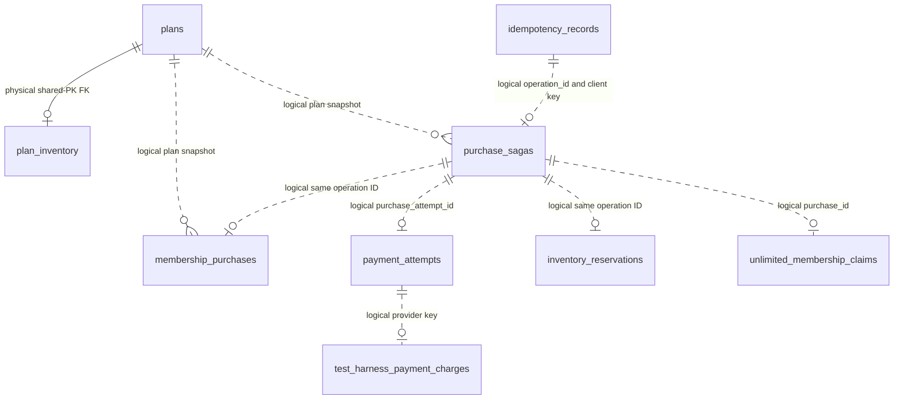

# Data model and persistence

Contents: [relationships](#relationships) · [tables](#table-reference) · [integrity](#integrity-and-lifecycle) · [configuration](#persistence-configuration).

## Relationships

Entities are in each capability's `repository.entity` package. There is no separate `members` table or membership aggregate with lifecycle dates: successful membership purchases are `membership_purchases` rows.

Only `PlanInventory.plan` is a mapped entity association: lazy, nonoptional, `@OneToOne @MapsId @JoinColumn(plan_id)`. Other edges are **logical correlations**, not declared foreign keys. A validation-failed idempotency record can exist without a saga. Reservations/claims precede a successful purchase, so their IDs cannot require a physical FK to that purchase.

## Table reference

Types below are **Java/JPA mappings**, not production SQL guarantees. UUID, Instant, enum and boolean SQL representations are chosen by Hibernate/dialect. Unannotated basic fields follow Boot's default naming conventions. `N` = `nullable=false` or non-null primary key, `Y` = nullable by mapping. Version columns have no explicit `nullable=false`; Hibernate manages their values. No additional `@Index` declarations or explicit check constraints are present. Primary-key/unique indexes may be generated by the database.

### `plans` — `plan.repository.entity.Plan`

| Column | Java mapping | Null | Constraint / meaning |
| --- | --- | --- | --- |
| `id` | UUID | N | PK; stable seed ID |
| `name` | String(120) | N | Display name |
| `type` | `PlanType` STRING(16) | N | `UNLIMITED` / `PACK` |
| `active` | boolean | N | Purchase eligibility |
| `price_cents` | int | N | Integer amount |
| `credits` | Integer | Y | Pack credits; null for unlimited |

### `plan_inventory` — `plan.repository.entity.PlanInventory`

| Column | Java mapping | Null | Constraint / meaning |
| --- | --- | --- | --- |
| `plan_id` | UUID | N | Shared PK and mapped FK to `plans.id` |
| `available_slots` | int | N | Unreserved sellable capacity |
| `reserved_slots` | int | N | Capacity held by pending operations |

No optimistic version is mapped here: conditional updates protect counters. Only the finite promo seed has a row. No cascade or orphan removal is declared for the plan association.

### `membership_purchases` — `membership.repository.entity.MembershipPurchase`

| Column | Java mapping | Null | Constraint / meaning |
| --- | --- | --- | --- |
| `id` | UUID | N | PK; successful purchase uses operation/saga ID |
| `member_name`, `member_key` | String(160) each | N | Original display name and normalized uniqueness key |
| `plan_id` | UUID | N | Logical plan ID; no mapped FK |
| `plan_name` | String(120) | N | Historical snapshot |
| `plan_type` | `PlanType` STRING(16) | N | Snapshot type |
| `price_cents` | int | N | Snapshot amount |
| `credits` | Integer | Y | Snapshot credits |
| `start_date` | LocalDate | N | Requested calendar date |
| `status` | `PurchaseStatus` STRING(16) | N | Current enum has `ACTIVE` |
| `payment_transaction_id` | String(120) | N | Provider/simulator result; no uniqueness constraint declared |
| `created_at` | Instant | N | Generated at microsecond precision on persistence if absent, matching H2 storage so creation, GET and replay return the same timestamp; not updatable |

There is no mapped version or automatic update/delete/expiry route. Purchase reads use snapshots rather than joins back to mutable catalogue fields.

### `purchase_sagas` — `membership.repository.entity.PurchaseSaga`

| Column | Java mapping | Null | Constraint / meaning |
| --- | --- | --- | --- |
| `id` | UUID | N | PK / operation ID |
| `client_idempotency_key` | String(255) | N | Unique; logical idempotency key |
| `provider_idempotency_key` | String(120) | N | Stable provider key; not declared unique on this table |
| `member_name`, `member_key` | String(160) each | N | Request display/normalized identity |
| `plan_id` | UUID | N | Logical plan ID |
| `plan_name` | String(120) | N | Snapshot |
| `plan_type` | `PlanType` STRING(16) | N | Snapshot |
| `price_cents` | int | N | Snapshot |
| `credits` | Integer | Y | Snapshot |
| `start_date` | LocalDate | N | Request |
| `has_finite_inventory` | boolean | N | Whether reservation is required |
| `correlation_id` | String(120) | N | Original operation correlation |
| `status` | `PurchaseSagaStatus` STRING(24) | N | Workflow state; [transitions](06-business-flows-and-execution.md#saga-state-machine) |
| `failure_status` | Integer | Y | Stored HTTP failure status |
| `failure_code` | String(80) | Y | Stable failure/manual-review marker |
| `failure_message` | String(500) | Y | Stored diagnostic/public failure text |
| `next_recovery_at` | Instant | Y | Due recovery/backoff time; null for excluded terminal/manual states |
| `recovery_lease_until` | Instant | Y | Per-saga recovery ownership expiry |
| `created_at` | Instant | N | Persistence timestamp, not updatable |
| `updated_at` | Instant | N | Last entity activity, refreshed on dirty update |
| `version` | Long / `@Version` | Y | Optimistic version; conditional lease claim also increments it |

### `unlimited_membership_claims` — `membership.repository.entity.UnlimitedMembershipClaim`

| Column | Java mapping | Null | Constraint / meaning |
| --- | --- | --- | --- |
| `member_key` | String(160) | N | PK; one claim per normalized member |
| `purchase_id` | UUID | N | Unique logical operation/purchase ID |
| `status` | `UnlimitedClaimStatus` STRING(16) | N | `PENDING` / `ACTIVE` |

`newEntity` is transient and helps `Persistable` choose INSERT rather than silently merging a conflicting claim. Post-load/persist marks it no longer new. Activation checks expected purchase ID; compensation deletes only the matching pending claim. Active claims are not automatically expired.

### `inventory_reservations` — `inventory.repository.entity.InventoryReservation`

| Column | Java mapping | Null | Constraint / meaning |
| --- | --- | --- | --- |
| `id` | UUID | N | PK; logical operation ID |
| `plan_id` | UUID | N | Logical finite plan ID; no mapped FK |
| `status` | `ReservationStatus` STRING(16) | N | `RESERVED`, `COMMITTED`, `RELEASED` |

No version column; status CAS query chooses one winner for commit/release. Released/committed audit rows remain.

### `payment_attempts` — `payment.repository.entity.PaymentAttempt`

| Column | Java mapping | Null | Constraint / meaning |
| --- | --- | --- | --- |
| `id` | UUID | N | PK; separate payment attempt identity |
| `purchase_attempt_id` | UUID | N | Unique logical saga ID |
| `provider_idempotency_key` | String(120) | N | Unique |
| `member_name` | String(160) | N | Provider command data |
| `amount_cents` | int | N | Provider command amount |
| `correlation_id` | String(120) | N | Original correlation |
| `status` | `PaymentAttemptStatus` STRING(16) | N | `CREATED`, `PROCESSING`, `SUCCEEDED`, `DECLINED`, `FAILED`, `UNKNOWN` |
| `last_failure_type` | `FailureType` STRING(16) | Y | `TRANSIENT`, `PERMANENT`, `UNKNOWN` |
| `provider_transaction_id` | String(120) | Y | Confirmed result |
| `last_failure_message` | String(500) | Y | Last failure text |
| `attempt_count` | int | N | Incremented before each provider attempt; one row records multiple invocations |
| `created_at`, `updated_at` | Instant each | N | Persistence/activity times; creation not updatable |
| `version` | Long / `@Version` | Y | Rejects stale outcome/attempt updates |

### `idempotency_records` — `idempotency.repository.entity.IdempotencyRecord`

| Column | Java mapping | Null | Constraint / meaning |
| --- | --- | --- | --- |
| `client_key` | String(255) | N | PK; trimmed client key |
| `request_hash` | String(64) | N | SHA-256 canonical request hex |
| `operation_id` | UUID | N | Unique logical saga ID |
| `provider_idempotency_key` | String(120) | N | Unique |
| `status` | `IdempotencyStatus` STRING(16) | N | `IN_PROGRESS`, `COMPLETED`, `FAILED` |
| `purchase_id` | UUID | Y | Logical completed purchase ID |
| `failure_status` | Integer | Y | Terminal replay status |
| `failure_code` | String(80) | Y | Terminal replay code |
| `failure_message` | String(500) | Y | Terminal replay message |
| `created_at`, `updated_at` | Instant each | N | Persistence/activity; creation not updatable |
| `version` | Long / `@Version` | Y | Guards concurrent lifecycle writes |

The response is reconstructed from a stored purchase ID or stored failure, not persisted as an arbitrary response JSON blob. There is no retention/expiry cleanup.

### `test_harness_settings` — `testharness.repository.entity.TestHarnessSetting`

| Column | Java mapping | Null | Constraint / meaning |
| --- | --- | --- | --- |
| `id` | UUID | N | PK |
| `setting_key` | String(150) | N | Unique allow-listed setting |
| `setting_value` | String(500) | N | Validated string value/counter |
| `description` | String(500) | Y | Human-readable meaning |
| `enabled` | boolean | N | Whether stored override is used |
| `updated_at` | Instant | N | Updated on insert/update |
| `updated_by` | String(100) | Y | Optional caller-supplied audit text |
| `version` | Long / `@Version` | Y | Concurrent setting changes |

Tables/entities are mapped even when the harness components are disabled; rows are not automatically seeded. Default views are synthesized by the settings service.

### `test_harness_payment_charges` — `testharness.repository.entity.SimulatedPaymentCharge`

| Column | Java mapping | Null | Constraint / meaning |
| --- | --- | --- | --- |
| `id` | UUID | N | PK |
| `provider_key` | String(120) | N | Unique simulator idempotency key |
| `transaction_id` | String(120) | N | Unique simulated transaction |
| `amount_cents` | int | N | Recorded amount |
| `created_at` | Instant | N | Set on persistence, not updatable |

No version. This existing table now backs all simulated payments, including normal mode with the harness disabled. `SimulatedPaymentLedgerTransaction` performs lookup/insert in REQUIRES_NEW. `SimulatedPaymentLedger` resolves a unique-key collision only after rollback, via a fresh REQUIRES_NEW lookup. Replays validate amount equality before returning the original transaction; mismatches neither return it nor create another charge. This is simulated provider evidence, not a real accounting ledger. Durability follows the backing database; in-memory H2 loses it on JVM exit.

### `shedlock` — explicit JDBC DDL, not a JPA entity

[Authoritative schema](../src/main/resources/schema.sql): `name VARCHAR(64) PRIMARY KEY NOT NULL`, `lock_until TIMESTAMP(3) NOT NULL`, `locked_at TIMESTAMP(3) NOT NULL`, `locked_by VARCHAR(255) NOT NULL`. There is no entity version or FK. The scheduler uses lock name `purchaseSagaRecovery`; the JDBC provider uses database time. Rows are retained when unlocked; expiration/release changes their timestamps.

## Integrity and lifecycle

Database constraints protect unique client operations, payment/provider correlations, and unlimited ownership. Conditional JPQL protects capacity and reservation state transitions. Versions protect entity updates. Validation protects allowed requests/settings; it is not a substitute for constraints. No database-level nonnegative/check constraints are declared for the counters; the conditional-update protocol maintains them.

Initialization, reservation/preparation, finalization and compensation have different atomic boundaries, described in [architecture](02-architecture-and-design.md#transaction-boundaries). The saga ID becomes the purchase ID; payment attempt ID is distinct. There are no declared cascade deletes or orphan removal. Tests explicitly delete their own fixtures; no public business DELETE endpoint exists.

## Persistence configuration

Default and `local` use the same in-memory H2 database, Hibernate `ddl-auto=update`, Open Session in View disabled, and Spring SQL initialization `mode=always` for ShedLock DDL. The `local` profile only enables the harness. Integration tests use a random H2 database, `create-drop`, disabled scheduling and explicit recovery times. JVM exit resets demo data; startup checks seed IDs and does not overwrite existing plans/capacity.

No Flyway/Liquibase migrations or PostgreSQL driver/profile are included. Production adoption requires durable connection settings, controlled migrations (including lock DDL), database-specific concurrency/isolation tests and network timeouts. Logical reference columns are not currently backed by foreign keys; adding them must account for pre-purchase workflow rows and historical snapshots.
