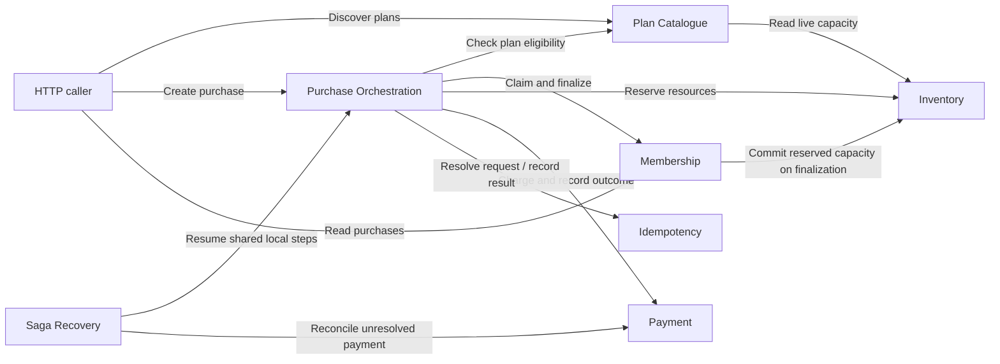

# Application components and responsibilities

Contents: [scope](#scope-and-terminology) · [collaboration](#component-collaboration) · [plans](#plan-catalogue) · [orchestration](#purchase-orchestration) · [membership](#membership) · [inventory](#inventory) · [payment](#payment) · [idempotency](#idempotency) · [recovery](#saga-recovery) · [infrastructure](#supporting-infrastructure) · [fault simulation](#faultinjectable-simulation).

## Scope and terminology

These are logical modules in **one Spring Boot deployment**, sharing a relational DataSource. Neither a component below nor a Java `service` package is a separately deployed service. Components collaborate through injected Java objects and repository access, not internal HTTP calls.

This guide identifies functional ownership and the main collaborators worth opening in the code. [Architecture](02-architecture-and-design.md) owns design rationale and transaction boundaries. [Runtime flows](06-business-flows-and-execution.md) trace a successful purchase, payment outcomes, interruption windows and recovery. API and entity details remain in [03](03-api-reference.md) and [04](04-data-model.md).

## Component collaboration

Arrows show logical interactions, not network boundaries. A catalogue's live-capacity read is repository access to Inventory-owned state; it does not call an Inventory HTTP API.



Recovery also uses the shared compensation path to coordinate resource release and idempotency failure. Those collaborations are local calls, with their runtime order shown in [06](06-business-flows-and-execution.md#recovery-worker-and-locks).

## Plan Catalogue

Owns plan metadata, eligibility lookup and idempotent seed initialization. `PlanQueryService` combines cached catalogue metadata from `PlanCatalogQueryService` with live inventory availability. `PlanPurchaseLookup` supplies the validated snapshot used by a new purchase, and `PlanSeeder` inserts missing seed plans/capacity without resetting existing activity.

HTTP discovery calls the query path; Purchase Orchestration calls eligibility lookup. Inactive plans remain visible to discovery but cannot start a new purchase. Inventory owns changing capacity; the catalogue cache does not contain it. A failed eligibility check stops purchase initialization before resources or payment are acquired.

Open [PlanQueryService](../src/main/java/com/glofox/memberships/plan/service/query/PlanQueryService.java) or [PlanPurchaseLookup](../src/main/java/com/glofox/memberships/membership/service/purchase/PlanPurchaseLookup.java). Cache rationale belongs in [02](02-architecture-and-design.md#read-caching).

## Purchase Orchestration

Owns coordination of a logical purchase and its persisted saga, rather than owning every resource it touches. `PurchaseService` resolves replay or new work through `PurchaseInitializationService`. `PurchaseSagaOrchestrator` starts a fresh flow using `PurchaseSagaFlowFactory`; each flow keeps its own stable context, discovered payment result and guarded step order. Mutable per-purchase context is never stored on the singleton factory.

The flow delegates reservation coordination to `PurchaseResourceReservationTransaction` and payment preparation to `PurchasePaymentPreparation`, then calls Payment and Membership. Resource writes and their saga transition must succeed together. The durable saga remains authoritative if an in-memory flow stops; Recovery resumes persisted work rather than reusing that failed flow object. HTTP failure alone does not establish that a payment failed or that a recoverable idempotency record should be closed.

Open the short [PurchaseSagaOrchestrator](../src/main/java/com/glofox/memberships/membership/saga/orchestration/PurchaseSagaOrchestrator.java) and [flow factory](../src/main/java/com/glofox/memberships/membership/saga/orchestration/flow/PurchaseSagaFlowFactory.java). Runtime ordering is in [successful purchase](06-business-flows-and-execution.md#successful-purchase); atomicity owners are in the [transaction table](02-architecture-and-design.md#transaction-boundaries).

## Membership

Owns successful purchase snapshots and the pending/active unlimited-membership claim. `UnlimitedMembershipClaimService` creates/releases claims and delegates activation to `UnlimitedClaimActivation`. `PurchaseFinalizer` and `PurchaseFinalizationTransaction` coordinate creation of the successful snapshot with Inventory, Idempotency and saga completion. `PurchaseQueryService` serves authoritative purchase reads and completed-request replay.

Orchestration calls claim/finalization work; Recovery reuses finalization after a confirmed payment. Claims enforce one pending or active unlimited membership per normalized name, while packs can coexist. An existing snapshot can be finalized again only with a matching payment transaction; failed finalization must not leave a partial active purchase. Automatic expiry and cancellation are outside the implemented scope.

Open [PurchaseFinalizationTransaction](../src/main/java/com/glofox/memberships/membership/service/purchase/PurchaseFinalizationTransaction.java) or [UnlimitedMembershipClaimService](../src/main/java/com/glofox/memberships/membership/service/claim/UnlimitedMembershipClaimService.java). See [claim scenarios](06-business-flows-and-execution.md#limited-inventory-and-unlimited-claims) for concurrent requests and cleanup.

## Inventory

Owns finite available/reserved capacity and each purchase's reservation lifecycle. `InventoryReservationService` and `InventoryReservationWriter` coordinate resource operations; `PlanInventoryRepository` changes capacity and `InventoryReservationRepository` controls the winning reservation-state transition. Capacity is stored in the existing plan inventory table even though Inventory owns the changing counts.

Orchestration reserves before payment. Membership finalization commits a reservation; shared compensation releases it, including during Recovery. Repeated release/commit must not change capacity twice. Catalogue reads expose current available capacity without changing it. Exhaustion stops the purchase before charging, and an aborted combined reservation rolls back every newly acquired resource.

Open [InventoryReservationService](../src/main/java/com/glofox/memberships/inventory/service/reservation/InventoryReservationService.java). The [runtime race scenarios](06-business-flows-and-execution.md#limited-inventory-and-unlimited-claims) show outcomes; [02](02-architecture-and-design.md#concurrency-and-consistency) explains the consistency mechanisms.

## Payment

Owns provider invocation, durable attempt evidence and classification of provider results. In the purchase payment step, `PurchasePaymentProcessor` manages eligible synchronous retries and success recording; `PurchasePaymentFailureHandler` records non-retryable outcomes and invokes compensation only for definitive failures. `PaymentAttemptStore` maintains attempt evidence. These purchase-specific coordinators collaborate with the `PaymentGateway` port, its `AlwaysSucceedingPaymentGateway` adapter and `SimulatedPaymentLedger`.

`PaymentCommand`, `PaymentResult` and `FailureType` are separate types in `payment.model`. Orchestration supplies the stable provider key; Recovery reuses it when payment is unresolved. The simulator ledger is available even with fault injection disabled and validates key/amount replay independently of purchase finalization. A charge can succeed before local success recording fails, so that persistence failure must not be classified as a new provider decline or compensated as unpaid.

Open [PurchasePaymentProcessor](../src/main/java/com/glofox/memberships/membership/saga/orchestration/payment/PurchasePaymentProcessor.java), [PurchasePaymentFailureHandler](../src/main/java/com/glofox/memberships/membership/saga/orchestration/payment/PurchasePaymentFailureHandler.java) or [PaymentGateway](../src/main/java/com/glofox/memberships/payment/PaymentGateway.java). The [outcome matrix](06-business-flows-and-execution.md#payment-outcomes-and-compensation) owns the result-by-result behavior; [02](02-architecture-and-design.md#retry-policies) owns retry configuration.

## Idempotency

Owns the client request key, canonical payload hash and stored in-progress/completed/failed result. `IdempotencyService` decides whether work may start or must replay, `CanonicalPurchaseRequestHasher` defines semantic request equivalence, and `IdempotencyRecordStore` persists the lifecycle.

Purchase initialization coordinates creation with the initial saga. Finalization and compensation supply terminal results; replay uses Membership's stored purchase or the original stored error. The client key identifies the logical request, while Payment receives a distinct provider key. A recoverable saga keeps idempotency in progress so a later retry can discover completion without starting another purchase.

Open [IdempotencyService](../src/main/java/com/glofox/memberships/idempotency/service/operation/IdempotencyService.java). Concrete replay/race outcomes are in [06](06-business-flows-and-execution.md#idempotency-scenarios), with full HTTP rules in [03](03-api-reference.md#idempotency).

## Saga Recovery

Owns selecting unfinished persisted workflows and choosing their next safe action. `PurchaseRecoveryScheduler` invokes `PurchaseSagaRecoveryService`; `PurchaseSagaStore` provides eligible state and claims, and `PurchasePaymentOutcomeStore` coordinates payment/saga evidence. `RecoveryPaymentGateway` bounds provider waiting; `PurchaseSagaRecoveryTransaction` handles safe pre-resource abandonment.

Recovery reuses Orchestration's finalization entry point and shared compensation, without invoking the normal fluent purchase chain again. Persisted payment evidence determines whether to finalize, reconcile, compensate or stop for manual review. One candidate's error must not abort unrelated candidates. Scheduling is optional; programmatic recovery remains available, but there is no HTTP trigger.

Open [PurchaseSagaRecoveryService](../src/main/java/com/glofox/memberships/membership/saga/recovery/PurchaseSagaRecoveryService.java). The [worker sequence](06-business-flows-and-execution.md#recovery-worker-and-locks) owns operational behavior; [02](02-architecture-and-design.md#scheduler-and-lease-coordination) explains coordination guarantees and limits.

## Supporting infrastructure

| Support | Role and detailed reference |
| --- | --- |
| Repositories and JPA | Implement each component's persistence operations. Entities remain under their owning `repository/entity` packages; [04](04-data-model.md) owns schemas |
| Optimistic retry | Supplies fresh local transactions for eligible conflicts; [02](02-architecture-and-design.md#retry-policies) owns policy and boundaries |
| Local Spring Cache | Caches catalogue metadata only; [02](02-architecture-and-design.md#read-caching) owns the trade-off |
| ShedLock and availability probes | Coordinate scheduled entry and expose process health; see [coordination design](02-architecture-and-design.md#scheduler-and-lease-coordination) and [health API](03-api-reference.md#health-and-probes) |
| Correlation and logging | Carry request/workflow identifiers across collaborators and the recovery worker; [06](06-business-flows-and-execution.md#observability) owns log interpretation |
| Local test harness | Settings and AOP inject controlled scenarios into existing components; [07](07-local-setup-and-manual-testing.md) owns setup/manual execution |

### FaultInjectable simulation

`@FaultInjectable` lets the local test harness replace a Spring bean method with a simulation selected by runtime settings. When a non-NORMAL scenario is selected and the harness is enabled, it invokes the simulation method instead of the normal method body. The normal method body does not execute for that call.

For example, [AlwaysSucceedingPaymentGateway](../src/main/java/com/glofox/memberships/payment/AlwaysSucceedingPaymentGateway.java) annotates its `charge` method with:

```java
@FaultInjectable(
    value = PAYMENT_CHARGE_OPERATION,
    simulationMethod = "simulateCharge"
)
```

`value` identifies the operation and therefore which scenario setting to read. `simulationMethod` names the public method in the decorated class that implements the simulation.

| Operation constant | Scenario setting | Simulation method |
| --- | --- | --- |
| `PAYMENT_CHARGE_OPERATION` | `payment.behavior` | `simulateCharge` |
| `INVENTORY_RESERVE_OPERATION` | `inventory.behavior` | `simulateReserveOne` |
| `MEMBERSHIP_ACTIVATE_OPERATION` | `membership.behavior` | `simulateActivate` |

The operation names come from `testharness.constant.Constants`. See the [harness API reference](03-api-reference.md#local-test-harness) for accepted setting values and defaults.

The [FaultInjectionAspect](../src/main/java/com/glofox/memberships/testharness/service/FaultInjectionAspect.java) controls execution:

1. **Application gate:** `app.test-harness.enabled=true` registers the aspect; the `local` profile enables it. With the gate disabled, the annotation has no effect.
2. **Runtime selection:** if `test-harness.enabled` is false, the original method runs. Otherwise, the aspect reads the operation's scenario. `NORMAL`, including an unrecognized operation key, also runs the original method.
3. **Simulation invocation:** for a non-NORMAL scenario, the aspect invokes the named simulation method reflectively with the original arguments. Payment simulations apply the configured `payment.delay-ms` first. The simulation can read the selected scenario through `FaultInvocationContext.current()` and return a domain result or throw a typed domain exception.
4. **Cleanup and propagation:** the scenario is thread-local and cleared in a `finally` block after invocation. Reflection wrappers are removed so callers receive the underlying exception, preserving normal payment/error classification.

At startup, nonblank simulation method names are checked for a public method with the same parameter types in the same order and a compatible return type. The annotation's empty default skips that validation; it does **not** disable simulation. An operation that can select a non-NORMAL scenario must name a valid simulation method.

**Proxy and transaction behavior:** calls must pass through the Spring proxy for the aspect to run; same-object calls bypass it. The simulation itself is invoked directly on the target, so its own AOP annotations, such as `@Transactional`, are not applied by the reflective call. Delegate transactional work to injected Spring-managed collaborators. An existing transaction may still be active; reflection does not create or remove one. See [transaction boundaries](02-architecture-and-design.md#transaction-boundaries) for the actual persistence boundaries.
