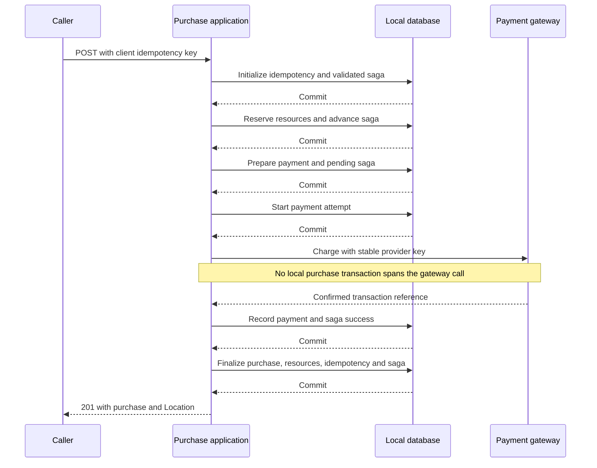
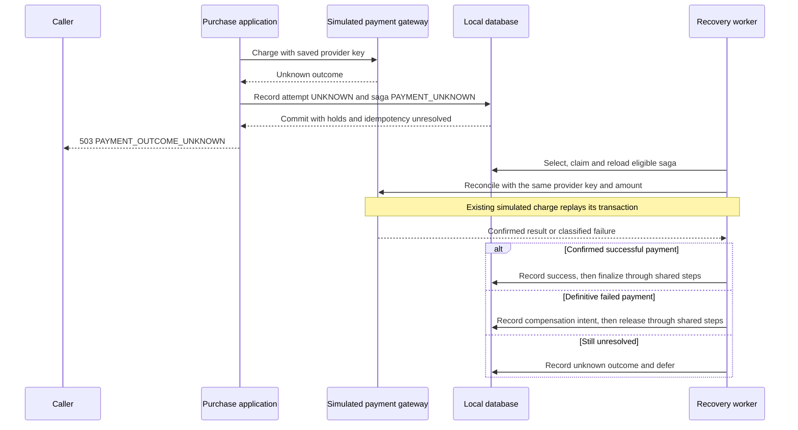
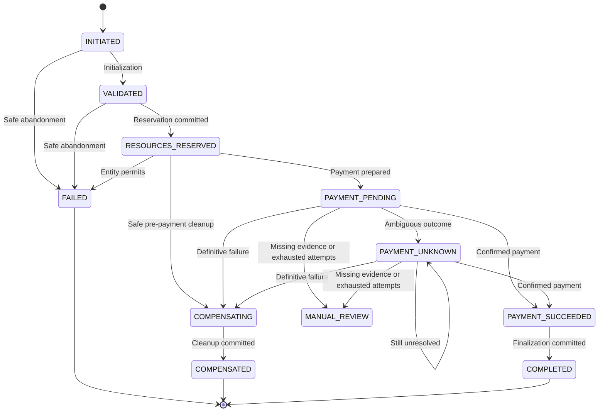

# Business flows and runtime execution

Contents: [success](#successful-purchase) · [inventory](#limited-inventory-and-unlimited-claims) · [payment](#payment-outcomes-and-compensation) · [local retry](#optimistic-lock-retry) · [states](#saga-state-machine) · [crashes](#crash-windows) · [worker](#recovery-worker-and-locks) · [idempotency](#idempotency-scenarios) · [observability](#observability).

This guide traces committed state and external calls. [02](02-architecture-and-design.md#transaction-boundaries) is the canonical transaction-boundary reference; [05](05-services-and-components.md) identifies component ownership. API payloads/status contracts and local scenario instructions remain in [03](03-api-reference.md) and [07](07-local-setup-and-manual-testing.md).

## Successful purchase

1. The correlation filter validates/generates the request ID, and MVC validates the request. Initialization normalizes the client key and hashes the semantic payload. An existing record resolves to replay or conflict before current plan eligibility is rechecked.
2. For new work, plan lookup checks eligibility and captures the purchase snapshot. Initialization commits idempotency `IN_PROGRESS` with the validated saga. `INITIATED` exists during creation; normal initialization first becomes visible as `VALIDATED`. A rejected plan instead stores terminal failed idempotency without a saga.
3. The fluent flow reserves applicable resources and commits `RESOURCES_RESERVED` with them. It then commits the payment attempt and `PAYMENT_PENDING`, using the provider key already saved at initialization.
4. Attempt start increments the saved attempt count and marks the attempt `PROCESSING`. Only after that commit does the processor call the gateway, outside a local purchase transaction.
5. A confirmed gateway result is saved as payment `SUCCEEDED` and saga `PAYMENT_SUCCEEDED`. The flow proceeds to shared finalization only after success recording returns.
6. Finalization commits the purchase snapshot, activated unlimited claim/committed reservation where applicable, completed idempotency and `COMPLETED` saga. The controller returns 201 with the purchase and Location. A repeat with the same key replays that purchase.

The factory creates a separate in-memory flow per purchase. Its guarded reserve → prepare → charge → finalize order prevents charging/finalizing out of order or reusing a failed flow object. Persisted state determines later recovery.

A failure between commits resumes from the last visible state, not from an assumed all-or-nothing purchase. The [crash windows](#crash-windows) distinguish payment evidence from locally completed membership work.

## Limited inventory and unlimited claims

When two new requests race for the last promo slot, one reservation succeeds and the other receives 409 `INVENTORY_EXHAUSTED` without calling Payment. The winner holds the slot while its result is unresolved. If any operation within combined reservation fails, its new claim, inventory reservation and saga transition roll back together.

After success, reservation `RESERVED→COMMITTED` consumes the held slot: reserved capacity decreases and available capacity stays reduced. After a definitive failure, `RESERVED→RELEASED` restores available capacity. A repeated commit/release does not change the counts again. If cleanup fails before commit, the reservation remains held for another recovery pass.

For unlimited plans, normalized-name requests compete for one pending/active claim. The loser receives 409 `ACTIVE_UNLIMITED_MEMBERSHIP_EXISTS` before charging. A successful purchase activates its pending claim; compensation deletes only the pending claim belonging to that operation. A held unknown-payment claim blocks a second unlimited purchase while recovery investigates. Packs can coexist and do not acquire this claim; no automatic monthly expiry is implemented.

[02](02-architecture-and-design.md#concurrency-and-consistency) explains why the database gates protect these races. [Atomic reservation tests](../src/integrationTest/java/com/glofox/memberships/membership/saga/orchestration/reservation/PurchaseResourceReservationAtomicityTests.java) exercise rollback between real resource and saga writes.

## Payment outcomes and compensation

| Gateway outcome | Synchronous handling | Persisted state and next action |
| --- | --- | --- |
| Confirmed success | Save success, then finalize | If finalization fails, confirmed payment remains; Recovery finalizes without charging again |
| Definitive decline | Save decline/compensation intent, release resources, return 402 | Successful cleanup leaves no purchase and closes idempotency as failed; failed cleanup remains recoverable |
| Transient technical failure | Retry eligible failures with the same command, up to three total calls | On exhaustion, save failure/compensation intent, clean up, return 503 `PAYMENT_PROVIDER_UNAVAILABLE` |
| Permanent technical failure | No synchronous retry; save failure and compensate | Return 502 `PAYMENT_PROVIDER_ERROR` after cleanup |
| Unknown/ambiguous outcome | Save UNKNOWN with a later due time; return 503 `PAYMENT_OUTCOME_UNKNOWN` | Retain resources and in-progress idempotency; reconcile using the saved provider key |
| Interrupted synchronous backoff | Restore interrupt flag; return 503 `PAYMENT_RETRY_INTERRUPTED` | Saved attempt remains `PROCESSING` with its retryable failure; saga remains `PAYMENT_PENDING` for recovery, without unsafe compensation |

The processor catches provider exceptions only around the gateway call. Attempt persistence, outcome persistence and compensation failures propagate independently. In particular, if the provider charged but saving success fails, the application does not convert that into a definitive failed charge or invoke another synchronous charge. Recovery must reconcile the saved payment reference. Exact retry/backoff settings are owned by [02](02-architecture-and-design.md#retry-policies).

Compensation reloads the saga and releases its held resources together with terminal saga/idempotency changes. If that work rolls back, `COMPENSATING` and in-progress idempotency remain for a later pass. Before resources exist, safe abandonment instead marks saga/idempotency failed. There is no refund or compensation path for a confirmed successful payment.

The port exposes `charge`, not a separate status-query operation. Both normal and harness payment paths use the simulated ledger. `TIMEOUT_AFTER_PROCESSING` can commit a ledger charge and then report UNKNOWN; reconciliation replays the same key/amount instead of creating another charge. A concurrent ledger insert loser rolls back before looking up the winner. An existing key with a different amount becomes UNKNOWN, retaining resources rather than assuming the earlier charge did not happen. Ledger transaction ownership and durability limits are in [02](02-architecture-and-design.md#transaction-boundaries).

## Optimistic-lock retry

A local optimistic conflict rolls back that step and reloads current state on another eligible attempt. Payment calls are outside this local retry. If the local policy exhausts, the caller receives controlled 409 `OPTIMISTIC_LOCK_RETRY_EXHAUSTED`; the last committed saga/payment state determines what Recovery can safely do. An error after an external charge does not erase the charge or authorize compensation as unpaid.

See [02's retry policies](02-architecture-and-design.md#retry-policies) for exact configuration and transaction semantics. The [interrupted-backoff regression](../src/integrationTest/java/com/glofox/memberships/membership/saga/orchestration/payment/PurchasePaymentProcessorRecoveryTests.java) verifies that saved pending work can recover to one purchase/charge.

## Saga state machine

The diagram shows entity-legal transitions. Normal initialization commits at `VALIDATED`. The entity permits direct `RESOURCES_RESERVED→FAILED`, but the recovery worker normally compensates that state. Identical completion and repeated unknown-state updates are supported.

`FAILED`, `COMPENSATED` and `COMPLETED` are definitive terminal saga states. `MANUAL_REVIEW` stops automatic recovery but does not prove a failed payment: resources and idempotency remain unresolved. No automatic transition out or public re-drive API is implemented.

A payment attempt starts from `CREATED`, `PROCESSING` or `UNKNOWN`, increments its saved count and becomes `PROCESSING`. Confirmed success is protected from downgrade to a decline/failure. Idempotency can close `IN_PROGRESS` as `COMPLETED` or `FAILED`, but arbitrary `FAILED→COMPLETED` repair is rejected. The complete enum/field reference is in [04](04-data-model.md).

## Crash windows

These windows assume the database rows remain available. Default H2 loses them on JVM exit; the integration tests simulate interrupted processing against surviving rows, not durable recovery across a default application restart.

| Interruption point | Committed state | Implemented response/recovery |
| --- | --- | --- |
| Before initialization, or between its writes before commit | No newly committed idempotency/saga pair | Same key can initialize later; neither half survives an aborted initialization |
| Plan rejected before saga creation | Terminal failed idempotency only | Replay the original plan error |
| After validation, before reservation | `VALIDATED`, idempotency in progress | Eligible recovery fails the operation before resources, without charging |
| During combined reservation | New resource and saga writes roll back together | Validated state remains; no partial held resources from that attempt |
| After reservation, before preparation | `RESOURCES_RESERVED` with holds and no attempt | Begin compensation and release without calling the provider |
| During preparation | Attempt and pending transition roll back together | Reserved state remains recoverable |
| After preparation, before provider invocation | `PAYMENT_PENDING` with a created/processing attempt | Reconcile the saved provider key while retaining resources |
| Provider succeeded, local success missing | Pending/unknown saga and unresolved attempt | Reconcile the same key; do not fail idempotency solely because local persistence retries exhausted |
| Success saved, finalization absent | `PAYMENT_SUCCEEDED` and successful attempt | Finalize only; do not call the provider again |
| During finalization | Its local writes all roll back | Confirmed payment remains available for later finalization; no partial successful purchase |
| During compensation | `COMPENSATING` and holds remain if cleanup rolls back | Retry cleanup before closing idempotency as failed |
| During recovery | Recoverable state and possibly an outstanding lease | State/defer updates normally clear the lease; abandoned leases can expire and be reclaimed |

For legacy/inconsistent `RESOURCES_RESERVED` with an existing attempt, Recovery moves it to pending and reconciles. Pending/unknown with a missing attempt goes to manual review. Confirmed-success with missing attempt is deferred as an error, rather than recharged. These paths use persisted evidence instead of assuming absence of a local purchase means no provider effect.

## Recovery worker and locks

The enabled scheduler invokes one recovery pass automatically. Disabling scheduling leaves programmatic `recoverPending` available; there is no HTTP trigger. [02](02-architecture-and-design.md#scheduler-and-lease-coordination) owns lock/lease design and constraints; [07](07-local-setup-and-manual-testing.md#configuration-and-profiles) lists configurable values.

A pass proceeds as follows:

1. **Select:** read recoverable states with due `nextRecoveryAt`, sufficient inactivity and no active lease, ordered by due time then ID. Clamp the requested batch to the configured bound.
2. **Admit and claim:** before each candidate, check interruption and the admission deadline. Restore its correlation context, atomically recheck state/version/age/due time/lease, then claim and reload it. A stale candidate that loses the claim is skipped.
3. **Choose from saved evidence:** abandon pre-resource work; compensate reserved work with no payment attempt; resume cleanup; or finalize a confirmed payment. For pending/unknown work, inspect the attempt first. Saved success finalizes; saved decline/failure compensates. Missing evidence requires manual review.
4. **Reconcile if unresolved:** below the six-started-attempt total budget, start the next saved attempt and call the bounded provider wrapper with the same key/amount. Save the result and finalize, compensate a definitive failure, or save UNKNOWN with a later due time. Exhausted unresolved attempts enter `MANUAL_REVIEW` without releasing resources.
5. **Defer or continue:** an unexpected candidate failure is logged and deferred when possible. Failure while reading diagnostics or deferring is isolated too; it does not intentionally abort the remaining candidates. Restore the caller's correlation context after each candidate.

Both due time and minimum inactivity must pass. A synchronous UNKNOWN outcome sets a due time 30 seconds ahead, but that is not a promise of a recovery call after 30 seconds: the default inactivity gate can keep it ineligible longer. Claiming changes the lease/version without refreshing activity time; subsequent state/defer updates refresh activity and clear the lease where implemented.

Timeout or interruption while waiting for the recovery provider is UNKNOWN, because cancellation does not prove that the charge never happened. A busy single worker rejects as TRANSIENT. During recovery, transient or unknown provider failures are saved as UNKNOWN for a later pass rather than consuming a synchronous retry loop inside that pass. The provider may finish an uncooperative outstanding call later.

The batch deadline limits **admission of another saga**, not execution of the current saga. Scheduler lock expiry is not a kill switch. See the [architecture timing limitations](02-architecture-and-design.md#scheduler-and-lease-coordination) for the assumptions behind these bounds and the [manual workflow](07-local-setup-and-manual-testing.md#import-and-run-in-postman) for observing completion.

## Idempotency scenarios

| Incoming request | Runtime result |
| --- | --- |
| New key and valid new purchase | Initialize one operation and execute the flow |
| Same key, semantically same payload, completed | Return 201 with the same purchase snapshot and ID |
| Same key and payload, still in progress | Return 409; retain the original operation for completion/recovery |
| Same key and payload, terminal failure | Replay the stored HTTP status/code/message with the current request correlation ID |
| Same key, different semantic payload | Return key-reused conflict without starting another purchase |
| Concurrent initialization with the same key | Losing insert rolls back before reading/resolving the winning record |

Provider success followed by failed outcome persistence remains in progress; reconciliation can later complete it. Compensation exhaustion also stays in progress until cleanup commits. `MANUAL_REVIEW` remains unresolved rather than being replayed as a definitive failure. Changing harness settings does not reopen a failed key. See [03](03-api-reference.md#idempotency) for canonicalization and the full HTTP contract.

## Observability

Follow `event=...` records by correlation ID and operation ID. INFO records lifecycle and payment/recovery outcomes; DEBUG records decisions, claims and eligible local retries; WARN records expected outages/exhaustion; ERROR includes unexpected failures with their stacks. Payment attempt IDs/counts and failure classifications connect a retry to its saved evidence. For example, correlate `membership.payment.attempt.started`, `membership.saga.recovery.finalize_only` and `membership.purchase.finalized` for a recovered operation.

The HTTP filter supplies the response correlation header and request MDC. Recovery restores the saga's original correlation ID for each candidate, then restores its caller's MDC; its provider worker propagates and clears MDC as well. Application log statements do not intentionally log raw client/provider keys, request bodies or member names.

Actuator health/probes expose availability, not purchase/recovery correctness. There are no bespoke pending-work metrics, public saga inspection routes or configured recovery alerts; see [operational limitations](02-architecture-and-design.md#limitations-and-review-caveats).
